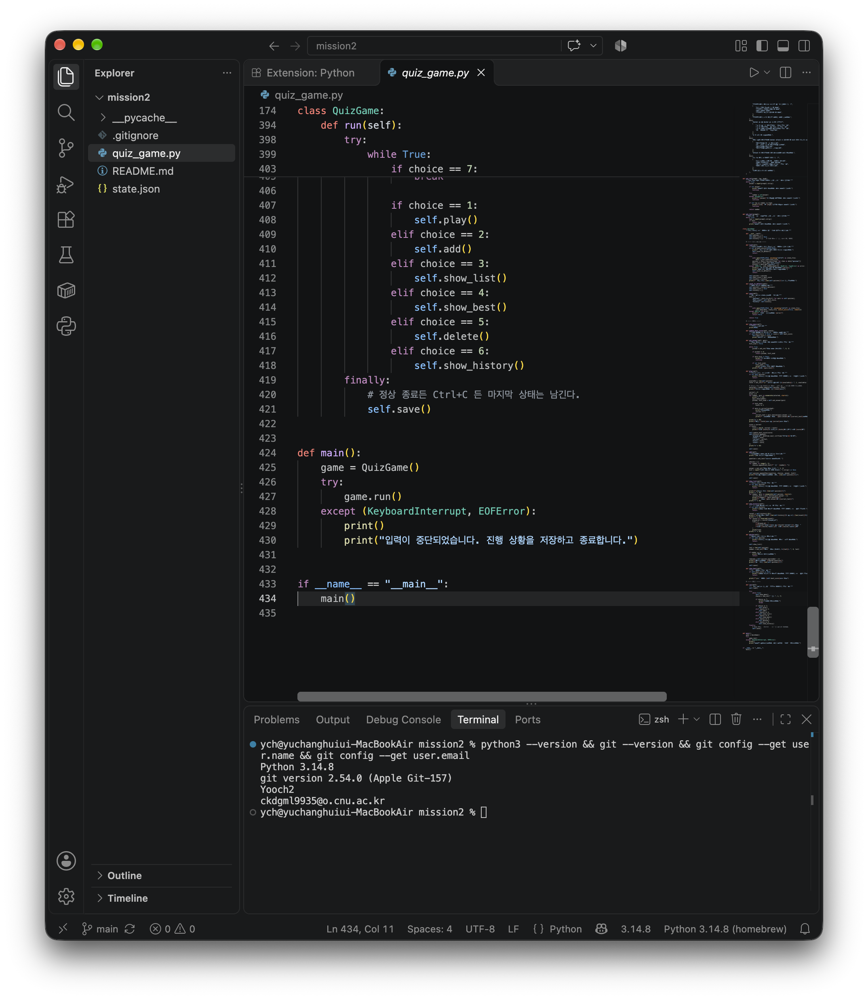
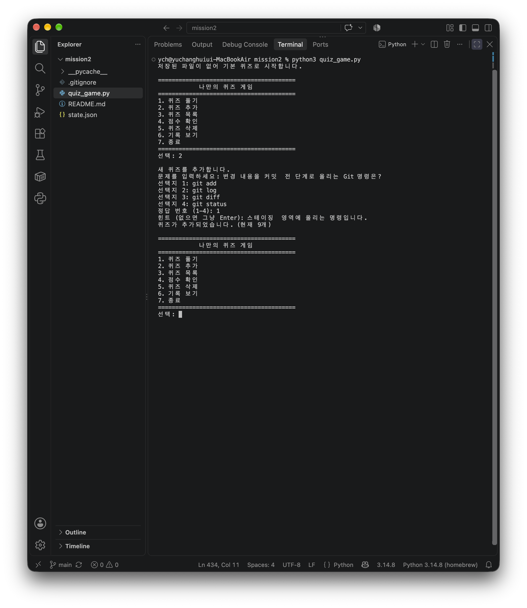
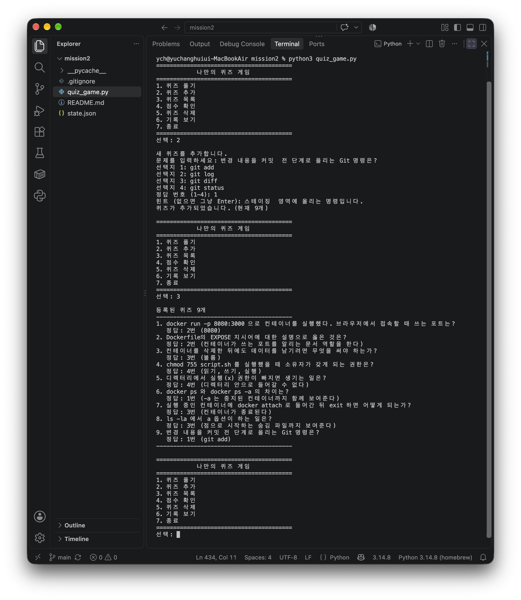
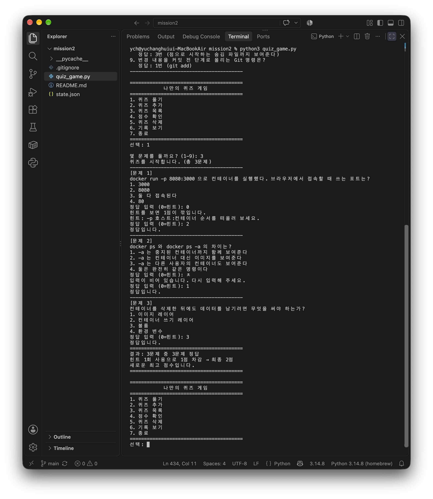
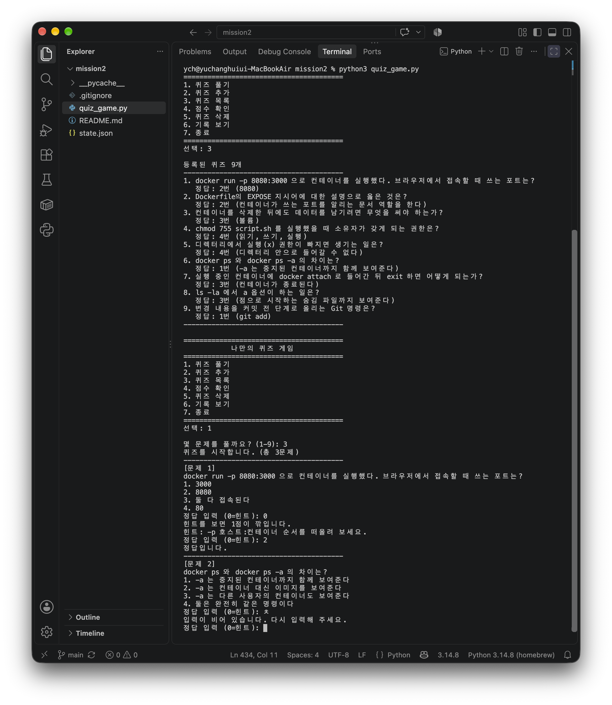
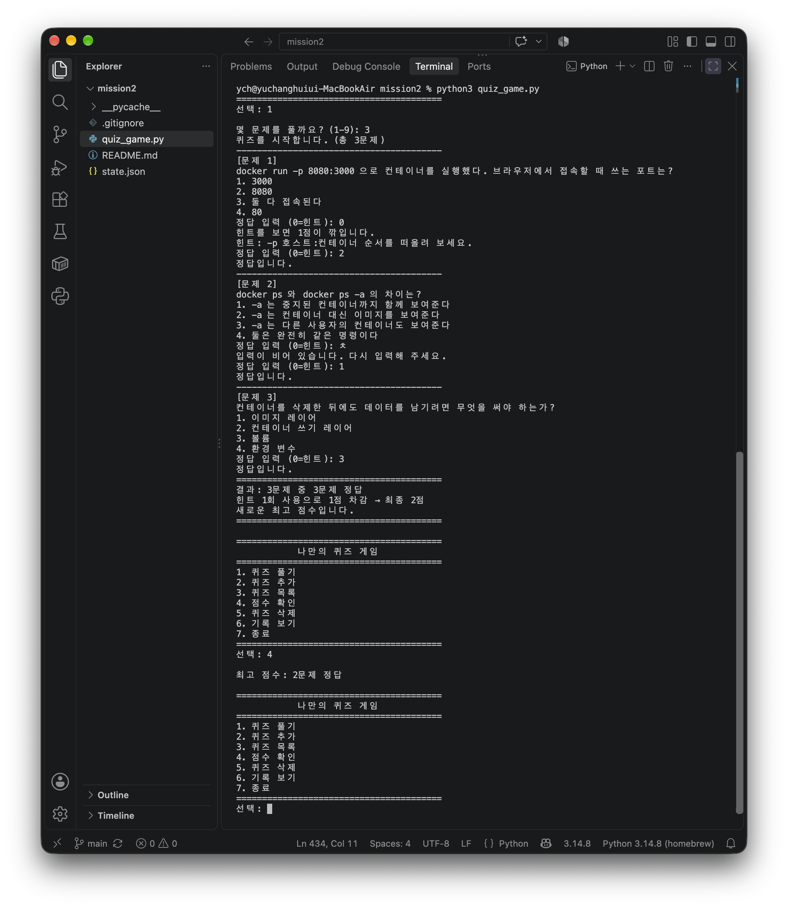
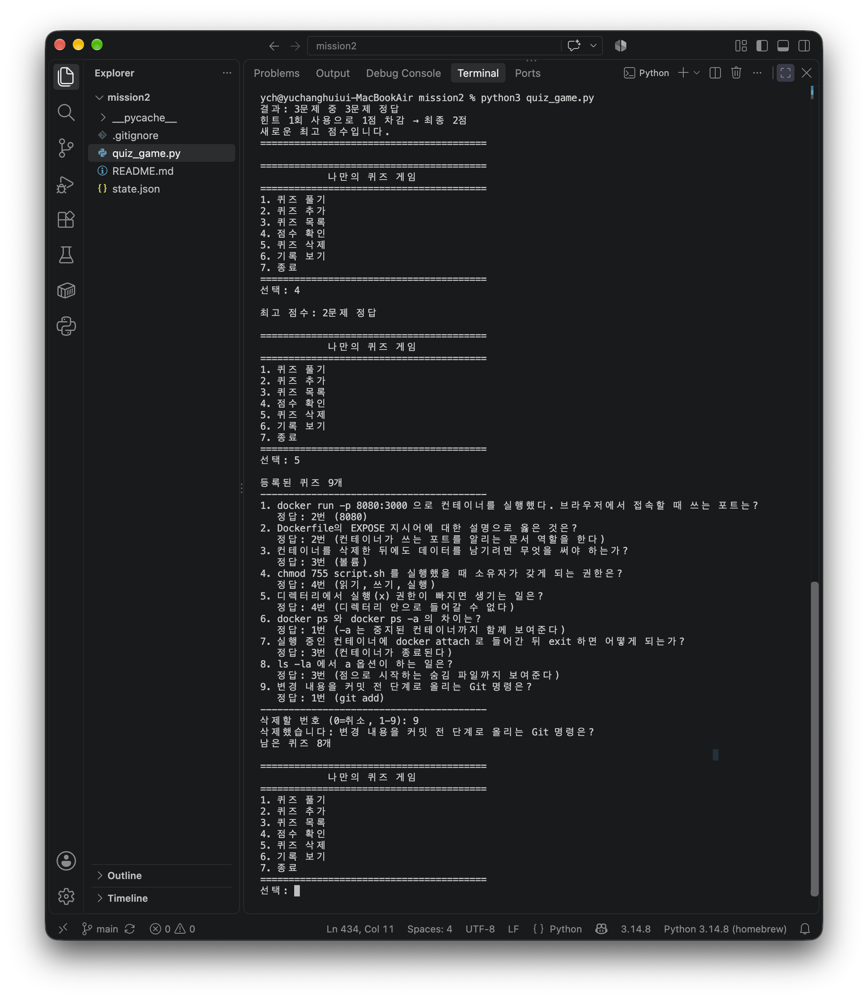
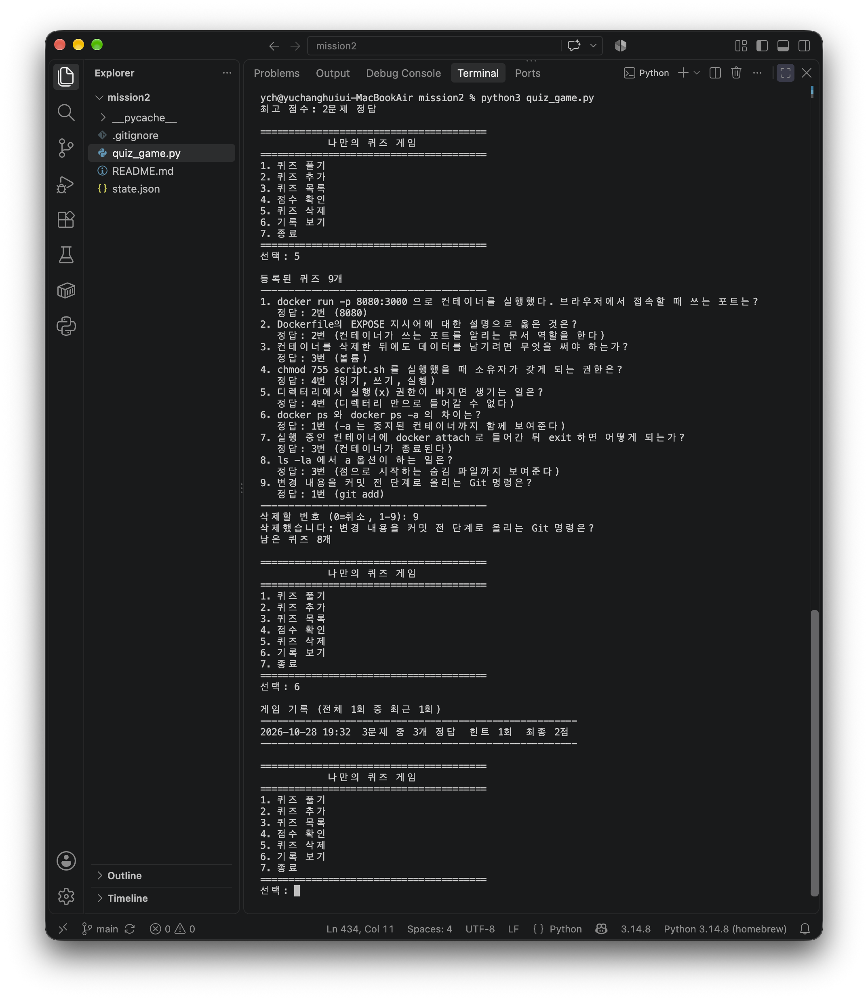
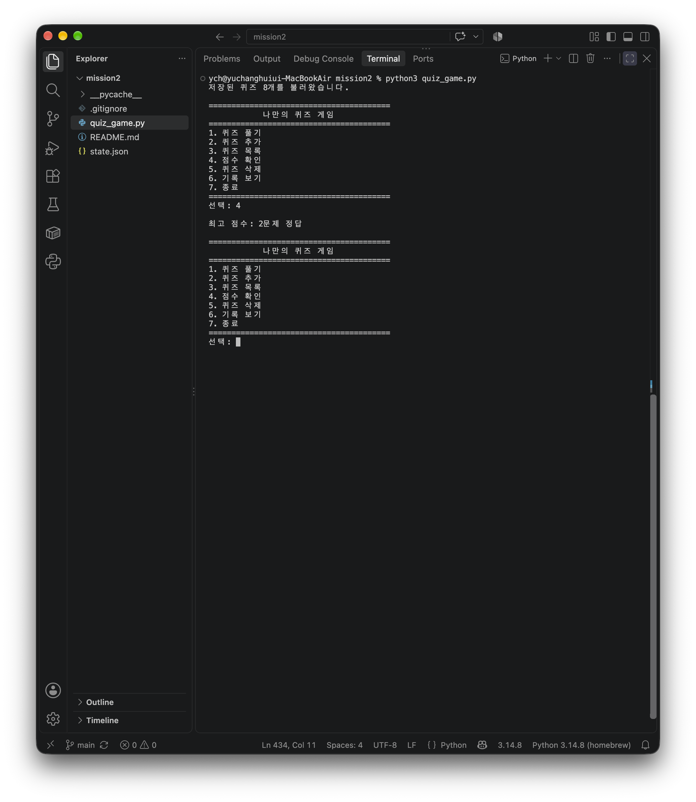
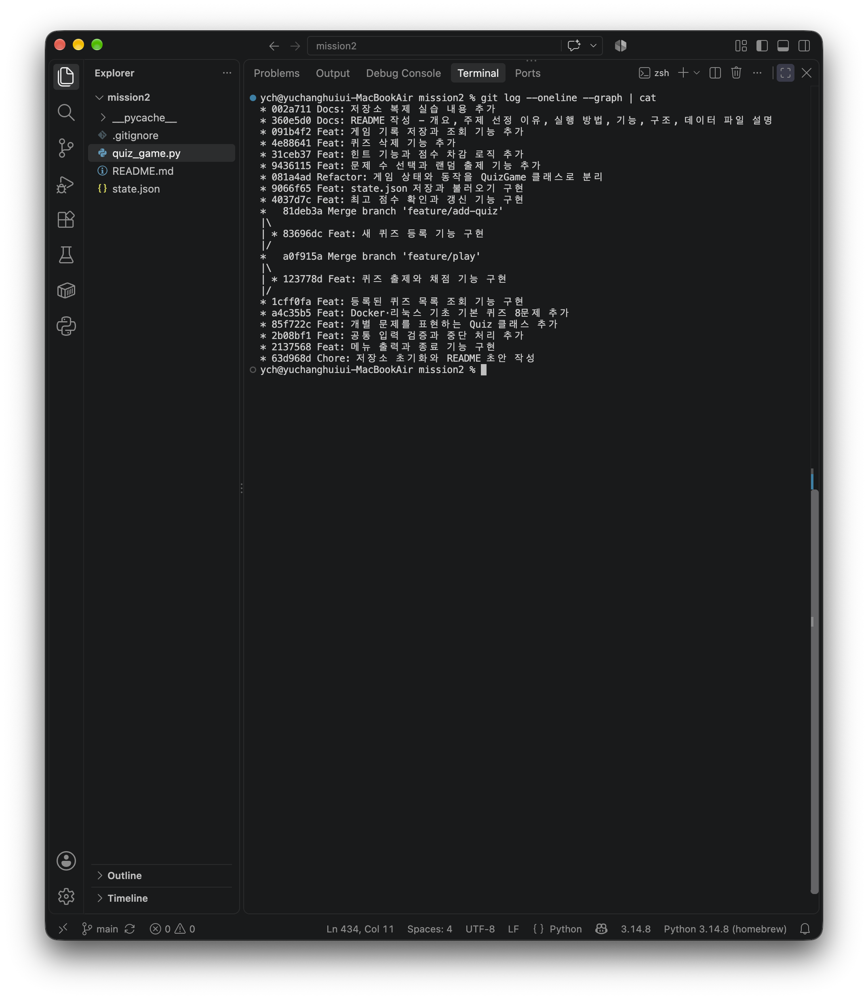

# 나만의 퀴즈 게임

| | |
|---|---|
| 저장소 | <https://github.com/Yooch2/codyssey-mission2> (Public) |
| 기본 브랜치 | `main` |
| 실행 | `python3 quiz_game.py` |
| 테스트 | `python3 test_quiz_game.py` (31개) |
| 기본 퀴즈 | **8개** (Docker·리눅스 기초) |

터미널에서 동작하는 Python 콘솔 퀴즈 게임이다.
Docker와 리눅스 기초를 주제로 한 객관식 문제를 풀고, 직접 문제를 추가하거나 삭제할 수 있다.
퀴즈와 점수는 `state.json`에 저장되어 프로그램을 껐다 켜도 그대로 남는다.

## 요구사항 대조표

미션 요구사항이 어디에서 확인되는지 정리했다.

### 기능 요구 사항

| # | 요구 | 구현 위치 | 확인 방법 |
|---|---|---|---|
| 1 | Git 저장소 설정, `.gitignore`·README 생성, 첫 커밋·푸시 | `.gitignore`, `README.md` | [Git 작업 방식](#git-작업-방식) · 커밋 `63d968d` |
| 2 | 메뉴 출력·선택·종료·잘못된 입력 처리 | `MENU`, `QuizGame.run`, `ask_int` | [실행 화면](#실행-화면) · [잘못된 입력 처리](#잘못된-입력-처리) |
| 3 | 공백 제거, 파싱 실패, 범위 밖, 빈 입력, `Ctrl+C`/EOF, 파일 없음·손상 | `ask_int`, `ask_text`, `QuizGame.run`의 `finally`, `QuizGame.load` | [입력 처리 기준](#입력-처리-기준) · 테스트 `TestAskInt`(6) `TestAskText`(2) |
| 4 | `Quiz` 클래스 — 문제·선택지 4개·정답 1~4, 메서드 | `Quiz` | [클래스별 핵심 메서드](#클래스별-핵심-메서드) · 테스트 `TestQuiz`(4) |
| 5 | 본인 주제 기본 퀴즈 5개 이상, `Quiz` 인스턴스로 생성 | `default_quizzes()` — **8개** | [퀴즈 주제와 선정 이유](#퀴즈-주제와-선정-이유) · 테스트 `test_기본_퀴즈는_다섯개_이상이고_형식이_맞다` |
| 6 | 퀴즈 풀기 (브랜치에서 작업 후 병합) | `QuizGame.play` | 커밋 `123778d` → 병합 `a0f915a` (`feature/play`) |
| 7 | 퀴즈 추가, 입력 검증, 파일 저장 | `QuizGame.add` | 커밋 `83696dc` → 병합 `81deb3a` (`feature/add-quiz`) · 테스트 `test_퀴즈_추가가_목록과_파일에_반영된다` |
| 8 | 퀴즈 목록, 퀴즈 없는 경우 처리 | `QuizGame.show_list` | [실행 화면](#퀴즈-목록) · 커밋 `1cff0fa` |
| 9 | 최고 점수 확인·갱신·저장, 안 푼 경우 처리 | `QuizGame.show_best`, `update_best_score` | 테스트 `test_최고_점수_갱신_규칙` · 커밋 `4037d7c` |
| 10 | `QuizGame` 클래스 — 속성과 메서드 분리 | `QuizGame` | [클래스별 핵심 메서드](#클래스별-핵심-메서드) · 커밋 `081a4ad` |
| 11 | `state.json` 저장·불러오기, 없음·손상 시 처리, UTF-8 | `QuizGame.load`, `save` | [데이터 파일](#데이터-파일-statejson) · 테스트 4종 · 커밋 `9066f65` |
| 12 | README 6항목 | 이 문서 | 아래 목차 |
| 13 | 저장소 clone → 수정 → push → pull | — | [저장소 복제 실습](#저장소-복제-실습) |

### 최종 결과물

| 요구 | 상태 |
|---|---|
| 메뉴에서 번호 선택 시 각 기능 동작 | [실행 화면](#실행-화면) 참조 |
| 퀴즈 풀기·추가·목록·점수 확인 동작 | 동일 |
| 본인 주제 퀴즈 5개 이상 | 8개 |
| 종료 후 다시 실행해도 유지 | [종료 후 다시 실행](#종료-후-다시-실행) 화면 |
| 클래스 2개 이상 | `Quiz`, `QuizGame` |
| 기능별 메서드 분리 | [클래스별 핵심 메서드](#클래스별-핵심-메서드) 표 |
| `state.json` UTF-8 저장·로드 | [실제로 저장된 state.json](#실제로-저장된-statejson) |
| 커밋 10개 이상 | 22개 |
| 브랜치 생성·병합 1회 이상 | 2회 (`feature/play`, `feature/add-quiz`) |
| `clone`·`pull` 각 1회 이상 | [저장소 복제 실습](#저장소-복제-실습) |
| README 6항목 | 개요 / 주제 선정 이유 / 실행 방법 / 기능 목록 / 파일 구조 / 데이터 파일 설명 |

### README 필수 6항목 위치

| 항목 | 섹션 |
|---|---|
| 프로젝트 개요 | [프로젝트 개요](#프로젝트-개요) |
| 퀴즈 주제와 선정 이유 | [퀴즈 주제와 선정 이유](#퀴즈-주제와-선정-이유) |
| 실행 방법 | [실행 방법](#실행-방법) |
| 기능 목록 | [기능 목록](#기능-목록) |
| 파일 구조 | [파일 구조](#파일-구조) |
| 데이터 파일 설명 | [데이터 파일 (state.json)](#데이터-파일-statejson) |

## 프로젝트 개요

Python 기본 문법만으로 입력과 출력의 흐름을 만들고, 클래스로 역할을 나누고,
JSON 파일로 데이터를 남기는 과정을 직접 해 보는 것이 목표였다.
외부 라이브러리는 쓰지 않았고 표준 라이브러리의 `json`, `os`, `random`, `datetime`만 사용했다.

클래스는 두 개로 나눴다. `Quiz`는 문제 하나를 표현하고, `QuizGame`은 여러 문제와 점수를 들고
게임 전체를 진행한다. 문제 하나와 게임 전체는 다루는 범위가 달라서 섞지 않았다.

## 퀴즈 주제와 선정 이유

주제는 **Docker와 리눅스 기초**다.

직전 미션에서 터미널, Docker, Git을 직접 세팅하면서 헷갈렸던 지점들이 있었다.
`EXPOSE`가 포트를 열어 주는 줄 알고 `-p 8080:80`으로 띄웠다가 접속이 끊겼던 일,
디렉터리의 `x` 권한이 실행이 아니라 진입 권한이라는 걸 `cd`가 막히고 나서야 알게 된 일 같은 것들이다.

그때 틀렸던 것들을 문제로 만들면 복습이 되겠다고 생각해서 이 주제를 골랐다.
기본 문제 8개는 전부 그 경험에서 나왔고, 힌트도 당시에 내가 뭘 몰랐는지를 기준으로 적었다.

## 실행 방법

Python 3.10 이상이 필요하다.

```
git clone https://github.com/Yooch2/codyssey-mission2.git
cd codyssey-mission2
python3 quiz_game.py
```

설치할 패키지는 없다.

처음 실행하면 `state.json`이 없으므로 기본 퀴즈 8개로 시작한다.
게임을 하면서 퀴즈를 추가하거나 문제를 풀면 같은 폴더에 `state.json`이 만들어진다.

## 테스트

동작을 자동으로 확인하는 테스트가 함께 있다. 표준 라이브러리 `unittest`만 쓴다.

```
python3 test_quiz_game.py
```

```
Ran 31 tests in 0.012s

OK
```

31개를 다섯 묶음으로 나눴다.

| 묶음 | 확인하는 것 |
|---|---|
| `TestQuiz` | 정답 판정, 딕셔너리 변환 왕복, 힌트 없는 예전 파일 호환 |
| `TestAskInt` | 정상·공백·빈 입력·문자·범위 밖·경계값(1과 5) |
| `TestAskText` | 빈 입력 재입력, 앞뒤 공백 제거 |
| `TestQuizGame` | 저장과 복원, UTF-8, 임시 파일 잔재, 손상 복구 3종, 최고 점수 갱신 규칙, 힌트 중복 차감 방지, 추가·삭제·취소 |
| `TestMenuFlow` | 메뉴 번호 1~6이 각각 해당 메서드를 부르는지, 7로 종료되는지, 중단 시 예외 처리 |

테스트는 `tempfile`로 임시 폴더를 만들어 그곳을 저장 경로로 쓴다.
실제 `state.json`은 건드리지 않으므로 게임 데이터가 날아갈 걱정 없이 돌릴 수 있다.

입력이 필요한 부분은 `unittest.mock.patch`로 `input`을 가짜로 바꿔서 확인한다.

```python
with patch("builtins.input", side_effect=["abc", "3"]):
    self.assertEqual(ask_int("> ", 1, 5), 3)
```

`abc`를 치면 다시 묻고, 그다음 `3`을 받아 돌려준다는 뜻이다.
사람이 매번 손으로 쳐 보지 않아도 입력 검증이 살아 있는지 확인된다.

## 기능 목록

실행하면 아래 메뉴가 나온다.

```
========================================
            나만의 퀴즈 게임
========================================
1. 퀴즈 풀기
2. 퀴즈 추가
3. 퀴즈 목록
4. 점수 확인
5. 퀴즈 삭제
6. 기록 보기
7. 종료
========================================
```

| 번호 | 기능 | 설명 |
|---|---|---|
| 1 | 퀴즈 풀기 | 몇 문제를 풀지 고르면 그만큼 무작위로 뽑아 출제한다. 푸는 중에 `0`을 누르면 힌트를 볼 수 있고, 힌트를 쓴 문제 수만큼 점수가 깎인다 |
| 2 | 퀴즈 추가 | 문제, 선택지 4개, 정답 번호, 힌트(선택)를 입력받아 등록하고 바로 파일에 저장한다 |
| 3 | 퀴즈 목록 | 등록된 문제와 각각의 정답을 보여준다 |
| 4 | 점수 확인 | 최고 점수를 보여준다. 아직 푼 적이 없으면 그렇게 안내한다 |
| 5 | 퀴즈 삭제 | 목록을 보여주고 번호를 받아 지운다. `0`을 누르면 취소된다 |
| 6 | 기록 보기 | 지난 게임 기록을 최근 10회까지 최신순으로 보여준다 |
| 7 | 종료 | 상태를 저장하고 끝낸다 |

### 실행 예시

문제는 무작위로 뽑히므로 실행할 때마다 나오는 문항이 달라진다. 아래는 한 번의 실행 기록이다.
입력한 값은 `선택: 1`처럼 프롬프트 뒤에 붙는다.

```
저장된 파일이 없어 기본 퀴즈로 시작합니다.

========================================
            나만의 퀴즈 게임
========================================
1. 퀴즈 풀기
2. 퀴즈 추가
3. 퀴즈 목록
4. 점수 확인
5. 퀴즈 삭제
6. 기록 보기
7. 종료
========================================
선택: 1

몇 문제를 풀까요? (1-8): 2
퀴즈를 시작합니다. (총 2문제)
----------------------------------------
[문제 1]
디렉터리에서 실행(x) 권한이 빠지면 생기는 일은?
1. 파일 이름 목록을 볼 수 없다
2. 디렉터리 이름을 바꿀 수 없다
3. 아무 영향이 없다
4. 디렉터리 안으로 들어갈 수 없다
정답 입력 (0=힌트): 0
힌트를 보면 1점이 깎입니다.
힌트: 디렉터리에서 x 는 실행이 아니라 다른 뜻입니다.
정답 입력 (0=힌트): 4
정답입니다.
----------------------------------------
[문제 2]
실행 중인 컨테이너에 docker attach 로 들어간 뒤 exit 하면 어떻게 되는가?
1. 컨테이너가 그대로 실행된다
2. 같은 이미지로 새 컨테이너가 생긴다
3. 컨테이너가 종료된다
4. 컨테이너가 자동으로 재시작된다
정답 입력 (0=힌트): 3
정답입니다.
========================================
결과: 2문제 중 2문제 정답
힌트 1회 사용으로 1점 차감 → 최종 1점
새로운 최고 점수입니다.
========================================
```

기록 보기 화면은 다음과 같다.

```
게임 기록 (전체 3회 중 최근 3회)
--------------------------------------------------------
2026-10-28 19:10  3문제 중 1개 정답  힌트 0회  최종 1점
2026-10-28 19:10  2문제 중 1개 정답  힌트 1회  최종 0점
2026-10-28 19:10  2문제 중 0개 정답  힌트 0회  최종 0점
--------------------------------------------------------
```

## 실행 화면

직접 실행한 화면이다. 모든 이미지는 `docs/img/`에 있다.

### 개발 환경



Python 3.14.8, Git 2.54.0, 편집기는 VSCode다.

### 퀴즈 추가



문제, 선택지 4개, 정답 번호, 힌트를 차례로 받아 등록한다. 등록 직후 파일에 저장된다.

### 퀴즈 목록



등록된 문제와 각각의 정답을 보여 준다.

### 퀴즈 풀기



몇 문제를 풀지 고르면 그만큼 무작위로 뽑는다. `0`을 누르면 힌트가 나오고 점수가 깎인다.

### 잘못된 입력 처리



숫자가 아닌 값, 빈 입력, 범위 밖 숫자 모두 안내 후 재입력으로 돌아간다.
프로그램이 중단되지 않는다.

### 결과와 점수 확인



맞힌 개수와 힌트 차감 후 최종 점수를 보여 주고, 최고 점수를 갱신한다.

### 퀴즈 삭제



목록을 보여 준 뒤 번호를 받아 지운다. `0`을 누르면 취소된다.

### 기록 보기



날짜·시각, 푼 문제 수, 맞힌 수, 힌트 횟수, 최종 점수를 남긴다.

### 종료 후 다시 실행



`저장된 퀴즈 8개를 불러왔습니다`와 최고 점수가 그대로 나온다.
앞 단계에서 삭제한 결과(9개 → 8개)까지 반영되어 있다.

### Git 이력



찍은 시점의 커밋 19개와 병합 커밋 두 개가 보인다.
이후 문서를 보완한 커밋이 더 쌓여서 현재 수는 이보다 많다. 최신 상태는 [Git 작업 방식](#git-작업-방식)의 명령으로 확인할 수 있다.

### 실제로 저장된 state.json

위 실행 뒤에 만들어진 파일이다. 퀴즈가 길어서 처음과 마지막 한 건씩만 옮겼다.

```json
{
  "quizzes": [
    {
      "question": "docker run -p 8080:3000 으로 컨테이너를 실행했다. 브라우저에서 접속할 때 쓰는 포트는?",
      "choices": [
        "3000",
        "8080",
        "둘 다 접속된다",
        "80"
      ],
      "answer": 2,
      "hint": "-p 호스트:컨테이너 순서를 떠올려 보세요."
    },
    {
      "question": "Git에서 브랜치를 만들면서 이동하는 명령은?",
      "choices": [
        "git branch",
        "git checkout -b",
        "git switch",
        "git merge"
      ],
      "answer": 2,
      "hint": "새 브랜치를 만들며 바로 이동합니다."
    }
  ],
  "best_score": 1,
  "history": [
    {
      "played_at": "2026-11-02 17:12",
      "total": 3,
      "correct": 1,
      "hints": 0,
      "score": 1
    }
  ]
}
```

맨 아래 퀴즈가 실행 중에 추가한 것이고, `hint`도 함께 저장됐다.
한글이 이스케이프되지 않고 그대로 들어가 있다.

## 입력 처리 기준

숫자를 받는 곳은 모두 `ask_int(prompt, low, high)` 하나를 거친다.

- 앞뒤 공백을 지우고 처리한다. `  3  `도 `3`으로 받는다
- 숫자가 아니면 안내하고 다시 묻는다
- 허용 범위 밖이면 범위를 알려 주고 다시 묻는다
- 빈 입력이면 안내하고 다시 묻는다

문제 문장이나 선택지처럼 글자를 받는 곳은 `ask_text(prompt)`를 쓰며 빈 입력을 거른다.

`Ctrl+C`나 입력 스트림이 끊기는 경우(`KeyboardInterrupt`, `EOFError`)에는
`run()`의 `finally`에서 현재 상태를 저장한 뒤 안내 메시지를 출력하고 끝낸다.
오류 추적 메시지가 그대로 쏟아지지 않는다.

**비정상 종료 뒤에 할 일**

`Ctrl+C`나 입력 종료로 끝난 경우에는 `finally`가 저장을 끝낸 뒤 나가므로 따로 할 일이 없다.
다시 실행하면 직전 상태가 그대로 올라온다.

터미널 창이 닫히거나 전원이 끊기는 등 `finally`조차 돌지 못한 경우라도,
저장은 임시 파일에 쓴 뒤 바꿔치기하는 방식이라 `state.json`은 **이전 저장 시점 그대로** 남는다.
마지막 한 판의 결과만 반영되지 않을 뿐 파일이 깨지지는 않는다.

그래도 이상하다고 느껴지면 다음 순서로 확인한다.

1. 다시 실행해서 첫 줄을 본다. `저장된 퀴즈 N개를 불러왔습니다`가 나오면 정상이다
2. `저장 파일을 읽을 수 없습니다`가 나오면 손상된 것이다. 프로그램은 기본 퀴즈로 계속 돌아간다
3. 손상된 원본은 지워지지 않고 그대로 있다. 열어 보고 고칠 수 있으면 고친 뒤 다시 실행한다
4. 고칠 수 없으면 `state.json`을 지운다. 기본 퀴즈 8개로 새로 시작한다

중요한 데이터라면 미리 `cp state.json state.backup.json`으로 복사해 두는 편이 낫다.

## 파일 구조

```
codyssey-mission2/
├── quiz_game.py      프로그램 전체 (클래스 2개, 보조 함수)
├── test_quiz_game.py 동작 확인 테스트 (unittest, 31개)
├── README.md         이 문서
├── .gitignore        __pycache__, state.json, .DS_Store 제외
├── docs/
│   └── img/          실행 화면 스크린샷 (README에서 참조)
└── state.json        실행하면 생기는 저장 파일 (저장소에는 올리지 않음)
```

`quiz_game.py` 안의 구성은 다음과 같다.

| 구성 | 역할 |
|---|---|
| `Quiz` 클래스 | 문제 하나. 속성은 `question`, `choices`, `answer`, `hint`. 메서드는 출력, 정답 확인, 저장용 변환 |
| `default_quizzes()` | 저장 파일이 없을 때 쓸 기본 문제 8개를 만든다 |
| `ask_int()`, `ask_text()` | 입력 검증. 게임 상태를 건드리지 않아 클래스 밖에 뒀다 |
| `QuizGame` 클래스 | 퀴즈 목록과 점수를 들고 메뉴를 진행한다. 파일 입출력도 여기서 한다 |
| `main()` | `QuizGame`을 만들어 실행하고 중단 상황을 처리한다 |

`test_quiz_game.py`는 제출 대상이 아니라 개발 중 확인용이지만, 어떤 동작을
보장하려 했는지가 그대로 드러나므로 함께 올렸다.

### 클래스별 핵심 메서드

**Quiz** — 문제 한 건

| 메서드 | 하는 일 |
|---|---|
| `__init__(question, choices, answer, hint=None)` | 문제·선택지·정답·힌트를 속성으로 담는다 |
| `show(number=None)` | 문제와 선택지를 화면에 찍는다 |
| `is_correct(picked)` | 고른 번호가 정답이면 `True` |
| `to_dict()` | 저장용 딕셔너리로 바꾼다 |
| `from_dict(data)` | 딕셔너리에서 객체를 만든다 (클래스 메서드) |

**QuizGame** — 게임 전체

| 메서드 | 하는 일 |
|---|---|
| `load()` | `state.json`을 읽어 상태를 채운다. 없거나 깨졌으면 기본 퀴즈로 |
| `reset_to_default()` | 기본 퀴즈 8개와 빈 점수·기록으로 되돌린다 |
| `save()` | 현재 상태를 임시 파일에 쓰고 바꿔치기한다 |
| `show_menu()` | 메뉴를 찍는다 |
| `ask_answer(quiz)` | 정답 번호를 받는다. `0`이면 힌트. `(고른값, 힌트사용)`을 돌려준다 |
| `update_best_score(score)` | 더 높으면 최고 점수를 갱신한다 |
| `play()` | 출제·채점·점수 갱신·저장 |
| `add()` | 새 퀴즈를 입력받아 등록하고 저장 |
| `show_list()` | 등록된 퀴즈를 보여 준다 |
| `delete()` | 번호를 받아 지우고 저장 |
| `show_best()` | 최고 점수를 보여 준다 |
| `show_history()` | 최근 10회 기록을 보여 준다 |
| `run()` | 불러오고 메뉴를 돌리고 끝날 때 저장 |

### 책임 분리와 흐름

같은 입력이라도 어디서 처리하느냐를 나눠 뒀다.

```
사용자 입력
    │
    ▼
ask_int / ask_text          ← 형식만 본다. 게임 상태를 모른다
    │  (항상 유효한 값)
    ▼
QuizGame 메서드              ← 의미를 판단한다. 상태를 바꾼다
    │  play / add / delete / show_*
    ▼
QuizGame.load / save        ← 파일로 내보내고 들여온다
    │
    ▼
state.json
```

**`Quiz`가 하지 않는 일**

- 입력을 받지 않는다. 사용자에게 묻는 것은 `QuizGame.add`가 하고, `Quiz`는 완성된 값만 받는다
- 자기를 파일에 저장하지 않는다. `to_dict`로 딕셔너리를 내줄 뿐, 파일을 여는 것은 `QuizGame.save`다
- 다른 문제를 모른다. 몇 번째 문제인지, 몇 개 중 몇 개인지는 `QuizGame`이 안다

**`QuizGame`이 하지 않는 일**

- 입력 형식을 검사하지 않는다. "숫자가 맞는가"는 `ask_int`가 끝내고 넘긴다.
  `QuizGame`은 "1~7 중 무엇을 골랐는가"라는 의미만 다룬다
- 정답 여부를 직접 비교하지 않는다. `quiz.is_correct(picked)`에게 묻는다

**입력이 잘못됐을 때의 흐름**

```
ask_int("선택: ", 1, 7)
   ├ "abc"  → 안내 출력 → continue → 다시 input()      ← QuizGame 까지 오지 않는다
   ├ ""     → 안내 출력 → continue → 다시 input()
   ├ "99"   → 안내 출력 → continue → 다시 input()
   └ "3"    → return 3                                 → QuizGame.run 이 받는다
```

잘못된 입력은 `ask_int` 안에서 끝난다. 게임 상태는 전혀 건드려지지 않으므로,
몇 번을 틀리게 쳐도 퀴즈 목록이나 점수가 변하지 않는다.

**`load()`와 `save()`의 반환 규약**

| 메서드 | 반환 | 의미 |
|---|---|---|
| `load()` | 없음 (`None`) | 성공이든 복구든 `self.quizzes`와 `self.best_score`가 항상 쓸 수 있는 상태가 된다. 호출한 쪽이 결과를 확인할 필요가 없다 |
| `save()` | `True` / `False` | 파일에 썼으면 `True`, 실패하면 안내를 출력하고 `False`. 지금은 호출한 쪽이 반환값을 쓰지 않지만, 저장 성공 여부로 분기해야 할 때를 위해 남겼다 |

`load()`가 값을 돌려주지 않는 이유는 **실패라는 상태가 없기 때문**이다.
파일이 없으면 기본 퀴즈, 깨졌으면 안내 후 기본 퀴즈로 간다. 어느 쪽이든 게임은 시작된다.

이 경계 덕분에 테스트가 쉬워진다. `ask_int`는 입력만 바꿔 가며 확인하면 되고,
`QuizGame`은 입력을 가짜로 넣어도 상태 변화만 보면 된다.

## 데이터 파일 (state.json)

**경로**: 프로젝트 루트. 코드에서는 `quiz_game.py`가 있는 폴더를 기준으로 잡는다.

```python
STATE_FILE = os.path.join(os.path.dirname(os.path.abspath(__file__)), "state.json")
```

그냥 `"state.json"`으로 두면 터미널의 현재 위치를 기준으로 하기 때문에
다른 폴더에서 실행하면 엉뚱한 곳에 저장된다. 그래서 스크립트 위치를 기준으로 잡았다.

**역할**: 등록된 퀴즈, 최고 점수, 게임 기록을 담는다. 인코딩은 UTF-8이다.

**스키마**

```json
{
  "quizzes": [
    {
      "question": "docker run -p 8080:3000 으로 컨테이너를 실행했다. 브라우저에서 접속할 때 쓰는 포트는?",
      "choices": ["3000", "8080", "둘 다 접속된다", "80"],
      "answer": 2,
      "hint": "-p 호스트:컨테이너 순서를 떠올려 보세요."
    }
  ],
  "best_score": 7,
  "history": [
    {
      "played_at": "2026-10-28 19:10",
      "total": 3,
      "correct": 1,
      "hints": 0,
      "score": 1
    }
  ]
}
```

| 키 | 타입 | 설명 |
|---|---|---|
| `quizzes` | 리스트 | 퀴즈 목록. 아래 제약을 만족해야 한다 |
| `best_score` | 정수 또는 `null` | 최고 점수. 아직 푼 적이 없으면 `null`. 0 이상 |
| `history` | 리스트 | 게임 기록. 없으면 빈 리스트로 읽는다 |

**필드별 제약**

| 위치 | 필드 | 제약 |
|---|---|---|
| `quizzes[]` | `question` | 비어 있지 않은 문자열 |
| `quizzes[]` | `choices` | 문자열 **4개**짜리 리스트. 개수가 다르면 출력과 정답 조회가 어긋난다 |
| `quizzes[]` | `answer` | 정수 **1~4**. 화면 번호 기준이라 인덱스로 쓸 때 1을 뺀다 |
| `quizzes[]` | `hint` | 문자열 또는 `null`. 없는 키여도 `null`로 읽는다 |
| `history[]` | `played_at` | `YYYY-MM-DD HH:MM` 형식 문자열 |
| `history[]` | `total` / `correct` / `hints` / `score` | 0 이상의 정수. `correct ≤ total`, `score = max(0, correct - hints)` |

`choices`가 4개가 아니거나 `answer`가 범위를 벗어나는 파일은 지금 코드가 걸러내지 못한다.
읽을 때 예외가 나지 않으면 그대로 올라오고, 출제할 때 엉뚱한 값이 정답으로 비교된다.
`test_quiz_game.py`의 `test_기본_퀴즈는_다섯개_이상이고_형식이_맞다`가 기본 데이터에 대해서만
이 제약을 확인한다. 사용자가 직접 고친 파일까지 검증하려면 `load()`에 형식 검사를 넣어야 한다.

**중첩 구조를 택한 이유와 한계**

퀴즈 하나를 `{question, choices, answer, hint}` 객체로 묶고 그 배열을 `quizzes`에 담았다.
한 문제에 속한 값들이 한 덩어리로 움직여서 순서가 어긋날 일이 없고,
항목을 더할 때 키만 추가하면 되어 확장이 쉽다. `hint`를 나중에 넣을 때 실제로 그랬다.

**객체로 묶어서 생기는 비용**

좋기만 한 것은 아니다.

- **메모리를 더 쓴다.** 딕셔너리로 들고 있으면 될 것을 객체로 만들면 인스턴스마다
  속성 딕셔너리가 붙는다. 퀴즈 8개 수준에서는 차이가 없지만 수만 개라면 의미가 생긴다
- **변환 단계가 하나 는다.** 저장할 때 `to_dict`, 읽을 때 `from_dict`를 거쳐야 한다.
  딕셔너리를 그대로 썼다면 `json.dump`로 바로 끝났다
- **읽을 코드가 는다.** 클래스 정의와 메서드를 먼저 읽어야 흐름이 보인다.
  파일이 100줄짜리였다면 함수 몇 개가 더 빨리 이해됐을 것이다

그럼에도 클래스를 쓴 것은, 문제·선택지·정답이 **항상 같이 움직여야 하는 값**이라
따로 두면 인덱스가 어긋나는 순간 조용히 틀린 정답을 내놓기 때문이다.
이 위험이 위의 비용보다 크다고 봤다.

한계도 있다. 중첩이 깊어질수록 읽는 코드가 `data["quizzes"][0]["choices"][1]`처럼 길어지고,
중간 키가 하나라도 없으면 `KeyError`가 난다. 그래서 나중에 추가된 항목은 `.get()`으로 읽는다.
또 특정 조건의 문제만 꺼내려 해도 전체를 순회해야 한다.

**저장 시점**: 퀴즈를 추가하거나 삭제했을 때, 퀴즈를 다 풀었을 때, 그리고 프로그램이 끝날 때.

**파일이 없거나 깨진 경우**

- 파일이 없으면 기본 퀴즈 8개로 시작한다
- JSON 문법이 깨졌거나 필요한 키가 없으면 안내 메시지를 출력하고 기본 퀴즈로 초기화한다
- `OSError`, `json.JSONDecodeError`, `KeyError`, `TypeError`를 잡는다.
  `except Exception`으로 묶지 않은 것은 코드 버그까지 "파일 손상"으로 잘못 알리지 않기 위해서다

**예외별로 사용자에게 보여 주는 문구**

| 상황 | 잡는 예외 | 출력 |
|---|---|---|
| 파일이 아예 없음 | (예외 아님) | `저장된 파일이 없어 기본 퀴즈로 시작합니다.` |
| JSON 문법이 깨짐 | `json.JSONDecodeError` | `저장 파일을 읽을 수 없습니다 (Expecting value: ...).` + `기본 퀴즈 데이터로 새로 시작합니다.` |
| 필요한 키가 없음 | `KeyError` | `저장 파일을 읽을 수 없습니다 ('quizzes').` + 같은 복구 안내 |
| 자료 구조가 다름 | `TypeError` | 같은 형태 |
| 읽기 권한 없음·경로 문제 | `OSError` | 같은 형태. 메시지에 원인이 따라붙는다 |
| 쓰기 실패 | `OSError` | `저장하지 못했습니다: [Errno 13] Permission denied: ...` |

읽기 쪽은 어떤 예외든 **안내 후 기본 퀴즈로 시작**하므로 프로그램이 멈추지 않는다.

**로그를 따로 남기지 않는 이유**

예외 메시지를 화면에 그대로 출력할 뿐, 파일로 남기지는 않는다.
혼자 쓰는 콘솔 프로그램이라 문제가 생기면 화면에 바로 보이고,
로그 파일을 두면 그 파일 자체를 관리해야 해서 득보다 실이 크다고 봤다.

여러 사람이 쓰거나 백그라운드로 도는 프로그램이라면 달라진다. 그때는
표준 라이브러리 `logging`으로 예외가 난 시각·종류·스택을 파일에 남기고,
화면에는 사용자용 안내만 보여 주는 식으로 나눈다. 지금 구조라면 `load()`와 `save()`의
`except` 블록에 `logger.exception(...)` 한 줄씩 넣는 것으로 시작할 수 있다.

**권한이나 경로 문제일 때**

`state.json`이 있는 폴더에 쓰기 권한이 없으면 저장이 실패한다. 이때 프로그램은 죽지 않고
`저장하지 못했습니다`를 출력한 뒤 계속 돌아간다. 다만 그 세션의 변경은 파일에 남지 않는다.

같은 상황이 반복되면 확인할 것은 다음과 같다.

```
ls -ld .                 # 폴더에 쓰기 권한(w)이 있는지
ls -l state.json         # 파일이 읽기 전용(444 등)으로 바뀌지 않았는지
df -h .                  # 디스크가 가득 찼는지
```

폴더 권한 문제라면 `chmod u+w .`, 파일 권한 문제라면 `chmod 644 state.json`으로 푼다.

`hint`와 `history`는 나중에 추가한 항목이라 `data.get()`으로 읽는다.
그래서 이 항목들이 없는 예전 저장 파일도 오류 없이 불러온다.

### 저장 중 중단에 대한 대비

`open(파일, "w")`는 여는 순간 기존 내용을 지운다. 그 상태에서 쓰기가 끝나기 전에
프로그램이 죽으면 `state.json`이 잘린 채 남고 그동안 쌓은 데이터가 전부 사라진다.

그래서 임시 파일에 먼저 다 쓴 뒤 `os.replace`로 한 번에 바꿔치기한다.
`os.replace`는 같은 파일 시스템 안에서 원자적으로 동작하므로,
중간에 죽더라도 원본은 이전 상태 그대로 남는다.

```python
temp_file = STATE_FILE + ".tmp"
with open(temp_file, "w", encoding="utf-8") as state_file:
    json.dump(data, state_file, ensure_ascii=False, indent=2)
os.replace(temp_file, STATE_FILE)
```

쓰기에 실패하면 남은 임시 파일을 지우고 `False`를 돌려준다.

### 백업과 복구

프로그램이 자동 백업을 만들지는 않는다. 데이터가 퀴즈 목록과 점수뿐이고,
손상 시 기본 퀴즈로 복구되도록 되어 있어 치명적인 손실이 아니라고 판단했다.

직접 백업하려면 실행 전에 파일을 복사해 두면 된다.

```
cp state.json state.backup.json      # 백업
cp state.backup.json state.json      # 복구
```

**백업을 자동화하려면**

프로그램을 고치지 않고도 쉘에서 처리할 수 있다. 실행 전에 날짜별로 복사해 두는 방식이다.

```bash
# 실행할 때마다 백업본을 남기고 시작
cp state.json "backups/state_$(date +%Y%m%d_%H%M).json" 2>/dev/null
python3 quiz_game.py
```

이걸 `run.sh`로 만들어 두면 `./run.sh`만 치면 된다. 쌓인 백업은 주기적으로 지운다.

```bash
# 7일보다 오래된 백업 삭제
find backups -name 'state_*.json' -mtime +7 -delete
```

프로그램 안에 넣는다면 `save()`가 쓰기 직전에 기존 파일을 `state.json.bak`으로
복사하는 정도가 간단하다. 다만 백업본도 같은 폴더에 있어서 디스크 문제에는 함께 당한다.
진짜 보호가 필요하면 다른 저장소로 옮기는 편이 낫다.

이번에는 데이터가 작고 손상 시 기본 퀴즈로 복구되므로 자동화를 넣지 않았다.

손상된 파일을 만났을 때 프로그램은 안내 메시지를 내고 기본 퀴즈로 시작한다.
이때 손상된 원본은 그대로 남아 있으므로, 내용을 직접 열어 고칠 수 있으면
고친 뒤 다시 실행하면 된다. 다음 저장이 일어나기 전까지는 덮어써지지 않는다.

### JSON을 택한 이유

**사람이 읽을 수 있다.** 파일을 열면 어떤 문제가 몇 개 있고 점수가 얼마인지 바로 보인다.
저장이 잘못됐을 때 눈으로 원인을 찾을 수 있고, 손으로 고칠 수도 있다.

**파이썬 자료구조와 모양이 같다.** `dict`, `list`, `str`, `int`가 그대로 대응되어
변환 코드가 거의 필요 없다. `json.dump` 한 줄로 끝난다.

**언어를 가리지 않는다.** 나중에 웹이나 다른 도구에서 이 데이터를 읽어야 해도 그대로 쓸 수 있다.

**표준 라이브러리다.** 이번 미션은 외부 라이브러리가 금지라 설치가 필요한 형식은 쓸 수 없었다.

직접 형식을 정해 텍스트로 저장할 수도 있었지만, 그러면 구분자를 정하고 파싱도 직접 짜야 한다.
선택지에 쉼표가 들어가는 순간 깨지고, 중첩 구조는 더 어려워진다.

### JSON 파일 방식의 한계

지금 규모에서는 JSON 파일 하나로 충분하다. 퀴즈가 10개 안팎이고 기록도 몇 줄이라
읽고 쓰는 데 체감되는 시간이 없다.

다만 이 방식에는 구조적인 한계가 있다.

**전체를 한 번에 읽고 쓴다.** `load()`는 파일 전체를 파싱해 메모리에 올리고,
`save()`는 변경이 한 줄이어도 전체를 다시 쓴다. 퀴즈가 1000개가 되면 퀴즈 하나를
추가할 때마다 1000개를 통째로 직렬화한다. 데이터 크기에 비례해 저장 시간이 늘어난다.

**전부 메모리에 올린다.** 당장 필요한 문제가 3개여도 `self.quizzes`에는 전체가 들어 있다.
기록(`history`)은 지우지 않고 계속 쌓이므로 오래 쓸수록 파일과 메모리가 함께 커진다.

**부분 조회가 안 된다.** "최근 10회 기록만"을 보려 해도 전체를 읽은 뒤
`self.history[-10:]`로 잘라야 한다. 파일 중간만 읽는 방법이 없다.

**동시 접근에 취약하다.** 두 프로그램이 동시에 저장하면 나중에 쓴 쪽이 앞의 변경을 덮는다.
지금은 한 사람이 하나만 실행하는 전제라 문제가 되지 않는다.

**어느 규모부터 문제가 되나**

퀴즈 한 건이 JSON으로 약 250바이트다. 기록 한 줄은 약 100바이트다.
현재 측정한 저장·로드 시간은 9개 기준 1밀리초 미만이다.

| 퀴즈 수 | 파일 크기(대략) | 예상 영향 |
|---|---|---|
| ~100개 | 25KB | 체감 없음. 지금 방식으로 충분 |
| ~1,000개 | 250KB | 저장이 수십 밀리초. 퀴즈를 추가할 때 살짝 끊기는 느낌 |
| ~10,000개 | 2.5MB | 저장이 수백 밀리초. 메뉴를 누를 때마다 기다림이 느껴진다 |
| 100,000개 이상 | 25MB | 매번 전체를 파싱하므로 시작만 수 초. 사실상 못 씀 |

기록은 한 판에 한 줄씩 쌓인다. 하루 10판씩 1년이면 3,650줄, 약 365KB다.
퀴즈보다 먼저 커질 가능성이 높다.

**대략 1,000개 선부터** 다른 방식을 생각해 볼 만하다고 본다.

| 상황 | 대안 |
|---|---|
| 퀴즈가 1,000개 이상 | SQLite 같은 내장 데이터베이스. 표준 라이브러리 `sqlite3`로 쓸 수 있고 부분 조회와 인덱스가 된다 |
| 기록이 수천 줄로 쌓임 | 기록만 별도 파일로 분리하거나, 최근 N개만 남기고 오래된 것은 잘라내기 |
| 목록 화면이 길어짐 | 한 번에 20개씩 끊어 보여 주는 페이징 |
| 여러 명이 동시에 사용 | 파일 잠금 또는 서버를 둔 데이터베이스 |

위 숫자는 파일 크기에서 추정한 값이고 실제로 측정한 것은 아니다.
정확히 알려면 그 규모의 데이터를 만들어 저장·로드 시간을 재 봐야 한다.

이번 미션은 외부 라이브러리 사용이 금지되어 있고 데이터도 작아서 JSON을 택했다.

### state.json을 저장소에 올리지 않은 이유

실행할 때마다 내용이 바뀌는 데이터라 커밋에 섞이면 변경 이력이 지저분해진다.
또 미션 요구사항이 "파일이 없는 경우 기본 퀴즈 데이터를 사용한다"이므로,
저장소를 clone했을 때 파일이 없는 상태로 시작하는 쪽이 그 동작을 그대로 보여 준다.

## 개발 환경

| 항목 | 값 |
|---|---|
| OS | macOS 27.0.1 |
| Python | 3.14.8 (요구: 3.10 이상) |
| Git | 2.54.0 |
| 편집기 | Visual Studio Code |

외부 라이브러리는 사용하지 않았다.

## 수정 지점

기능을 바꾸거나 추가할 때 어디를 손봐야 하는지 정리한다. 파일은 `quiz_game.py` 하나다.

| 하고 싶은 일 | 손댈 곳 |
|---|---|
| 기본 퀴즈 내용·개수 변경 | `default_quizzes()` |
| 퀴즈에 새 항목 추가 (예: 난이도) | `Quiz.__init__`, `Quiz.to_dict`, `Quiz.from_dict`, `QuizGame.add` — 네 곳을 함께 고쳐야 한다 |
| 메뉴 항목 추가·순서 변경 | `MENU` 상수, `QuizGame.run`의 분기, `ask_int`의 범위 값 |
| 입력 검증 규칙 변경 | `ask_int`, `ask_text` |
| 점수 계산·힌트 차감 방식 변경 | `QuizGame.play`, `QuizGame.update_best_score` |
| 출제 방식 변경 (랜덤·문제 수) | `QuizGame.play`의 `random.sample` 부분 |
| 저장 파일 경로·형식 변경 | `STATE_FILE`, `QuizGame.load`, `QuizGame.save` |
| 저장 항목 추가 | `QuizGame.save`의 `data`, `QuizGame.load`의 읽기 부분, `QuizGame.__init__`, `reset_to_default` |
| 손상 파일 처리 방식 변경 | `QuizGame.load`의 `except` 블록 |
| 종료·중단 시 동작 변경 | `QuizGame.run`의 `finally`, `main()`의 `except` |

### 넣을까 검토했다가 뺀 것

**난이도와 카테고리.** `Quiz`에 `level`이나 `category`를 두면 "쉬운 것만 풀기",
"Docker 문제만 풀기" 같은 기능으로 이어진다. 저장 형식도 키 하나만 늘면 되고,
`data.get()`으로 읽으면 기존 파일과도 호환된다.

넣지 않은 이유는 **쓸 데가 없어서**다. 미션 요구에 없고, 지금 문제가 8개뿐이라
난이도로 걸러 봐야 한두 개만 남는다. 카테고리도 전부 Docker와 리눅스라 하나뿐이다.
값만 저장하고 아무 데서도 쓰지 않는 필드가 되어, 나중에 보는 사람이
"이건 왜 있지" 하고 헷갈릴 가능성이 더 크다고 판단했다.

문제가 수십 개로 늘고 주제가 갈라지는 시점에 넣는 것이 맞다고 본다.
그때 고칠 곳은 위 표의 "퀴즈에 새 항목 추가" 줄과 같다.

### 고칠 때 같이 돌려 볼 테스트

변경한 곳과 관련된 테스트를 먼저 돌리면 깨진 것을 바로 안다.
전체는 `python3 test_quiz_game.py`로 돌리고, 하나만 보려면 이름을 지정한다.

```bash
python3 -m unittest test_quiz_game.TestAskInt -v
```

| 손댄 곳 | 관련 테스트 |
|---|---|
| `default_quizzes()` | `TestQuizGame.test_기본_퀴즈는_다섯개_이상이고_형식이_맞다` |
| `Quiz.__init__` / `to_dict` / `from_dict` | `TestQuiz` 전체 (특히 `test_딕셔너리로_바꿨다_되돌려도_같다`, `test_힌트_없는_예전_파일도_읽힌다`) |
| `ask_int` | `TestAskInt` 전체 (6개) |
| `ask_text` | `TestAskText` 전체 (2개) |
| `QuizGame.load` | `test_파일이_없으면_기본_퀴즈로_시작한다`, `test_깨진_파일이면_기본_퀴즈로_복구한다`, `test_필요한_키가_없어도_복구한다`, `test_history_키가_없는_예전_파일도_읽힌다` |
| `QuizGame.save` | `test_저장한_뒤_다시_읽으면_그대로다`, `test_한글이_이스케이프되지_않는다`, `test_저장_후_임시파일이_남지_않는다` |
| `QuizGame.update_best_score` | `test_최고_점수_갱신_규칙` |
| `QuizGame.ask_answer` | `test_힌트를_보면_사용_여부가_참이_된다`, `test_같은_문제에서_힌트를_두번_봐도_한번으로_센다`, `test_힌트가_없는_문제에서_0을_누르면_안내만_한다` |
| `QuizGame.play` | `test_퀴즈가_없으면_풀기가_그냥_돌아온다` |
| `QuizGame.add` | `test_퀴즈_추가가_목록과_파일에_반영된다` |
| `QuizGame.delete` | `test_퀴즈_삭제가_목록과_파일에_반영된다`, `test_삭제를_0으로_취소하면_그대로다` |
| `MENU` / `QuizGame.run` 분기 | `TestMenuFlow` 전체 (3개) |

메뉴 번호를 바꾸면 `TestMenuFlow.test_각_번호가_해당_기능을_부른다`의 짝 표도 같이 고쳐야 한다.
테스트가 실패하는 것 자체가 "다른 곳도 고쳐야 한다"는 신호다.

### 항목을 추가할 때 주의할 점

`Quiz`에 새 속성을 넣으면 네 군데가 함께 바뀌어야 한다.

1. `__init__` — 기본값을 주어야 기존 호출이 깨지지 않는다
2. `to_dict` — 저장되도록 키를 추가
3. `from_dict` — `data.get("키")`로 읽어야 예전 파일도 열린다
4. `QuizGame.add` — 사용자에게 입력받는 부분

`hint`를 추가할 때 실제로 이 네 곳을 고쳤다. 특히 3번을 `data["키"]`로 쓰면
예전 저장 파일에서 `KeyError`가 나고, 프로그램은 이것을 "파일 손상"으로 오해해
기본 퀴즈로 초기화해 버린다.

## Git 작업 방식

커밋은 기능 단위로 나눴고, 메시지는 `Feat:`, `Refactor:`, `Docs:`, `Chore:` 접두어를 붙였다.
커밋 수는 아래 명령으로 확인할 수 있다. 이 문단을 쓰는 시점에 22개다.
README를 고치는 커밋이 뒤에 더 붙으므로 실제 수는 이보다 많을 수 있다.

```
$ git rev-list --count HEAD
22

$ git log --oneline --graph
* 12cf3d6 Docs: 실행 화면과 저장 파일 예시 첨부, 설계 판단 근거 보강
* adfcf09 Test: 동작 확인 테스트 추가 및 설계 근거 문서 보강
* dedbac1 Fix: 저장 중 중단에 대비한 원자적 쓰기 적용 및 문서 보강
* 002a711 Docs: 저장소 복제 실습 내용 추가
* 360e5d0 Docs: README 작성 - 개요, 주제 선정 이유, 실행 방법, 기능, 구조, 데이터 파일 설명
* 091b4f2 Feat: 게임 기록 저장과 조회 기능 추가
* 4e88641 Feat: 퀴즈 삭제 기능 추가
* 31ceb37 Feat: 힌트 기능과 점수 차감 로직 추가
* 9436115 Feat: 문제 수 선택과 랜덤 출제 기능 추가
* 081a4ad Refactor: 게임 상태와 동작을 QuizGame 클래스로 분리
* 9066f65 Feat: state.json 저장과 불러오기 구현
* 4037d7c Feat: 최고 점수 확인과 갱신 기능 구현
*   81deb3a Merge branch 'feature/add-quiz'
|\  
| * 83696dc Feat: 새 퀴즈 등록 기능 구현
|/  
*   a0f915a Merge branch 'feature/play'
|\  
| * 123778d Feat: 퀴즈 출제와 채점 기능 구현
|/  
* 1cff0fa Feat: 등록된 퀴즈 목록 조회 기능 구현
* a4c35b5 Feat: Docker·리눅스 기초 기본 퀴즈 8문제 추가
* 85f722c Feat: 개별 문제를 표현하는 Quiz 클래스 추가
* 2b08bf1 Feat: 공통 입력 검증과 중단 처리 추가
* 2137568 Feat: 메뉴 출력과 종료 기능 구현
* 63d968d Chore: 저장소 초기화와 README 초안 작성
```

두 군데가 갈라졌다 합쳐진 모양이 `feature/play`와 `feature/add-quiz` 브랜치를 병합한 지점이다.

퀴즈 풀기와 퀴즈 추가 기능은 `feature/play`, `feature/add-quiz` 브랜치에서 작업한 뒤
`--no-ff` 옵션으로 main에 병합했다.
`--no-ff`를 쓴 것은 그냥 `merge`하면 fast-forward가 일어나서
`git log --graph`에 브랜치를 쓴 흔적이 남지 않기 때문이다.

**커밋 메시지 형식**

```
<종류>: <무엇을 했는지 한 줄>
```

| 종류 | 쓰는 때 | 실제 사용한 예 |
|---|---|---|
| `Feat:` | 기능을 새로 만들었을 때 | `Feat: 힌트 기능과 점수 차감 로직 추가` |
| `Fix:` | 잘못 동작하던 것을 고쳤을 때 | `Fix: 저장 중 중단에 대비한 원자적 쓰기 적용 및 문서 보강` |
| `Refactor:` | 동작은 그대로 두고 구조만 바꿨을 때 | `Refactor: 게임 상태와 동작을 QuizGame 클래스로 분리` |
| `Docs:` | 문서만 손봤을 때 | `Docs: README 작성 - 개요, 주제 선정 이유, ...` |
| `Test:` | 테스트를 추가·수정했을 때 | `Test: 동작 확인 테스트 추가 및 설계 근거 문서 보강` |
| `Chore:` | 설정이나 잡일 | `Chore: 저장소 초기화와 README 초안 작성` |

"수정", "ㅇㅇ" 같은 메시지는 나중에 봤을 때 아무것도 알려주지 않으므로 쓰지 않았다.
한 줄만 보고 무엇이 바뀌었는지 알 수 있는지를 기준으로 삼았다.

**충돌이 났을 때**

이번에는 브랜치를 하나씩 따서 바로 합쳤기 때문에 충돌이 나지 않았다.
main이 그동안 움직이지 않아서다. 만약 났다면 다음 순서로 푼다.

```bash
git merge --no-ff feature/어떤것
# CONFLICT (content): Merge conflict in quiz_game.py

git status              # 어떤 파일이 충돌했는지
```

충돌한 파일을 열면 이런 표시가 들어 있다.

```
<<<<<<< HEAD
main 쪽 내용
=======
브랜치 쪽 내용
>>>>>>> feature/어떤것
```

둘 중 하나를 고르거나 합쳐서 쓰고, `<<<<<<<` `=======` `>>>>>>>` 세 줄은 지운다.
그다음 해결됐다고 알리고 병합을 마무리한다.

```bash
python3 test_quiz_game.py   # 합친 결과가 깨지지 않았는지 먼저 확인
git add quiz_game.py
git commit                  # 병합 커밋 메시지가 미리 채워져 있다
```

중간에 그만두고 싶으면 `git merge --abort`로 병합 전으로 돌아간다.

**병합 전에 확인한 것**

혼자 하는 작업이라 Pull Request나 코드 리뷰 절차는 두지 않았다. 대신 병합 전에
다음을 직접 확인하고 넘어갔다.

1. 브랜치에서 프로그램이 실제로 동작하는지 — 메뉴를 눌러 해당 기능을 써 본다
2. 기존 기능이 깨지지 않았는지 — 지금은 `python3 test_quiz_game.py`로 대신한다
3. `git status`가 깨끗한지 — 커밋하지 않은 변경을 들고 브랜치를 옮기지 않는다
4. 커밋 메시지가 무엇을 했는지 드러내는지

여럿이 하는 프로젝트라면 여기에 PR 생성, 리뷰어 지정, 승인 후 병합 규칙이 붙는다.
이번에는 그 자리를 테스트와 직접 확인으로 채웠다.
## 저장소 복제 실습

`clone`과 `pull`을 직접 써 보기 위해 저장소를 별도 폴더에 복제하고,
복제본에서 이 문단을 추가해 push한 뒤 원래 작업 폴더에서 pull로 가져왔다.

- `git clone <URL> <폴더명>` — 원격 저장소를 통째로 내려받아 새 폴더를 만든다.
  `.git` 디렉터리까지 함께 오기 때문에 커밋 이력이 전부 따라온다
- `git pull` — 원격에 새로 생긴 커밋을 현재 작업 폴더로 가져와 병합한다

clone은 저장소가 아직 없을 때 처음 한 번 받는 것이고,
pull은 이미 가지고 있는 저장소를 최신 상태로 맞추는 것이다.

두 명령은 커밋 이력에 남지 않으므로 `git reflog`로 확인한다.

복제한 폴더(`mission2-clone`)에서 본 기록이다.

```
$ git reflog --date=short
002a711 HEAD@{2026-10-28}: commit: Docs: 저장소 복제 실습 내용 추가
360e5d0 HEAD@{2026-10-28}: clone: from https://github.com/Yooch2/codyssey-mission2.git
```

원래 작업 폴더에서 `pull`로 가져온 기록이다.

```
$ git reflog --date=short | grep pull
002a711 HEAD@{2026-10-28}: pull: Fast-forward
```

복제본에서 만든 커밋 `002a711`이 원래 폴더로 넘어온 것을 두 기록에서 같은 해시로 확인할 수 있다.
